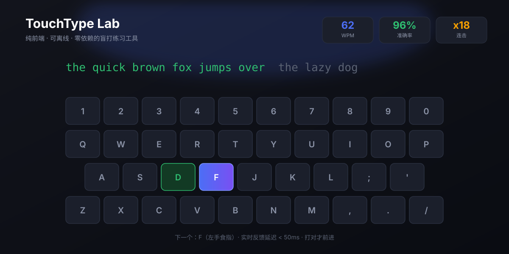
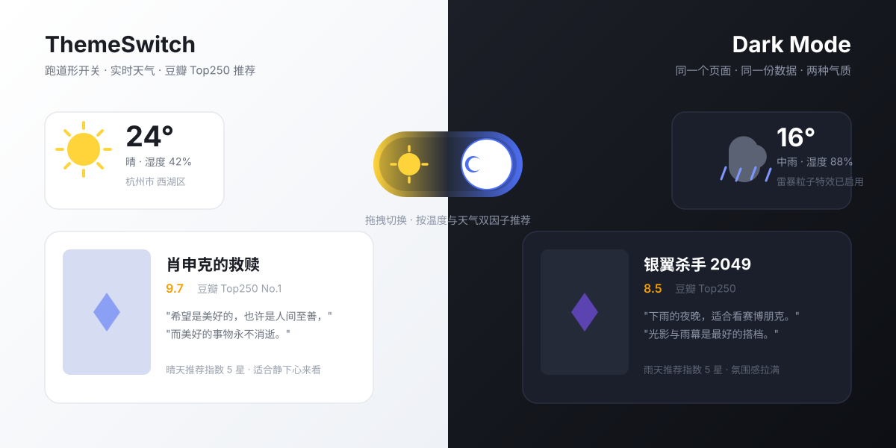
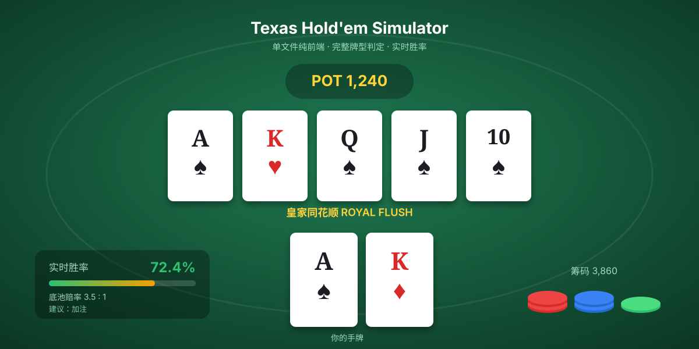
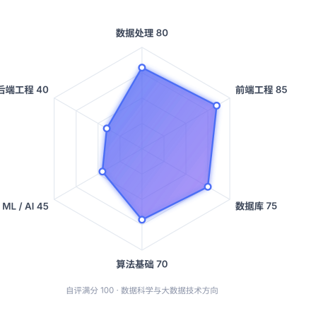

# 你好，我是 Tables（zzq1419）

**数据科学与大数据技术 · 本科在读 ｜ 目标：考研深造**

喜欢把脑子里冒出来的小想法，做成别人打开就能用的东西。

🌐 **[个人主页（GitHub Pages）](https://zzq1419.github.io/)**

---

## 👤 关于我

一个在数据和代码之间来回折腾的本科生。专业是**数据科学与大数据技术**，但我的兴趣一直比专业边界宽一点——比起"分析一份数据"，我更喜欢"做一个能跑起来的东西"。

课余时间我基本在做三件事：写小工具、折腾前端交互、琢磨数据怎么变成有用的东西。做过的东西都不大，但每一个都是完整能用的，不是课程作业式的半成品。

<table>
<tr>
<td align="center" width="33%">

**🧠 现在在学**

机器学习理论 分布式数据系统 后端工程（Spring Boot）

</td>
<td align="center" width="33%">

**🔭 接下来想做**

一个真正有后端的项目 一次完整的 Kaggle 竞赛 一篇能复现的论文

</td>
<td align="center" width="33%">

**🤝 想找人一起**

组队做项目 互相监督考研 交流数据/AI 方向

</td>
</tr>
</table>

### 兴趣爱好

| | |
|---|---|
| ⌨️ **键盘与打字** | 机械键盘和盲打是我少数能坚持下来的习惯，也是我做 [TouchType Lab](#-项目成果) 的直接原因——自己想练，就先造了个工具 |
| 🎬 **看电影** | 喜欢翻老片子，顺手爬了豆瓣 Top250 的数据做成推荐卡片，数据驱动地"今天看什么" |
| 🃏 **概率类游戏** | 德州扑克吸引我的是它的概率与决策结构，不是赌博本身，所以写了个模拟器来研究胜率计算 |
| 🛠️ **造轮子** | 享受"零依赖、单文件、双击就能跑"的完成感，也喜欢为了这个目标做取舍 |
| 🏸 **羽毛球** | 唯一能把我从屏幕前拽走的活动 |

### 想和你分享的几件小事

- **从"能用"到"好用"的距离**：我的第一个项目能跑起来，但代码是一坨。第二个项目开始注意结构拆分，第三个开始考虑无障碍（色盲友好配色、键盘导航）。这个转变比学会任何框架都重要。
- **"零依赖"是一种设计约束，不是偷懒**：`TouchType Lab` 要求 `file://` 双击可运行、断网可练，为此放弃了打包工具和 CDN，全部数据走 `localStorage`。约束反而让产品定位变清晰了。
- **爬虫教会我的比课程更多**：豆瓣 Top250 那次爬数据，撞上了反爬、编码、字段缺失一堆问题。处理脏数据的手感，是课堂上练不出来的。
- **GitHub Pages 是学生的免费服务器**：我的三个项目全部部署在 Pages 上，零成本，链接可以永久放在简历里。

---

## 🛠 技能栈

<table>
<tr>
<td width="50%" valign="top">

**编程语言**

**数据处理与分析**

</td>
<td width="50%" valign="top">

**Web 与工程**

**正在补齐**

</td>
</tr>
</table>

---

## 💻 项目成果

三个都已上线，点开即可体验，不需要任何安装。

### 1. TouchType Lab · 盲打练习网站

> 纯前端、可离线、零依赖的标准指法练习工具。

- **9 阶段渐进课程**：基准行 → 上排 → 下排 → 数字符号 → 单词 → 句子 → 长文 → 代码 → 中文
- **实时指法纠正**：击键延迟 < 50ms，下一个应击键与对应手指即时高亮；练习模式必须打对才前进
- **自适应难度**：依据最佳速度与近期准确率推算难度，每次最多提升 1 级，避免跳跃
- **数据可视化**：WPM / 准确率趋势曲线 + 按键级正确率热力图，用数据回答"我哪个键最常错"
- **无障碍设计**：色盲友好配色、高对比度、全键盘导航
- **技术要点**：经典 `<script>` 顺序加载，无打包、无 CDN，全部数据存 `localStorage`，保证 `file://` 离线可用

🔗 [在线体验](https://zzq1419.github.io/typing-practice/) ｜ [源码](https://github.com/zzq1419/typing-practice) ｜ `JavaScript · MIT`

---

### 2. ThemeSwitch · 明暗主题切换 + 天气实时电影推荐

> 跑道形开关切换明暗主题，接入实时天气，按当前天气从豆瓣 Top250 里推荐一部电影。

- **沉浸式天气效果**：阴天飘云、下雨下雪全屏粒子、雷暴闪电，全部 CSS/Canvas 手绘
- **数据 pipeline**：Python 爬虫抓取豆瓣 Top250（含评分、短评、海报），清洗落 CSV，前端本地消费
- **三级联动地区选择**：覆盖中国所有行政区，接入 Open-Meteo 实时天气 API 与 Nominatim 反向地理编码
- **设计细节**：太阳 ⇆ 月亮的跑道形开关动画，温度+天气双因子推荐逻辑

🔗 [在线体验](https://zzq1419.github.io/theme-switch/) ｜ [源码](https://github.com/zzq1419/theme-switch) ｜ `HTML · Python · MIT`

---

### 3. Texas Hold'em Simulator · 德州扑克模拟器

> 单文件纯前端德州扑克，从牌型判定到边池结算全部自己实现。

- **完整规则引擎**：皇家同花顺 → 高牌全牌型判定（含 A-5 轮子顺子）、盲注 / 加注 / 全下 / 边池结算
- **实时概率计算**：胜率、底池赔率、策略提示，把"感觉"变成数字
- **交互打磨**：翻牌动画、摊牌对比、五张最佳组合展示
- **进行中**：用 PeerJS (WebRTC) 做点对点联机，一人当主机、好友直连同桌

🔗 [在线试玩](https://zzq1419.github.io/texas-holdem-simulator) ｜ [源码](https://github.com/zzq1419/texas-holdem-simulator) ｜ `HTML · MIT`

---

## 📚 专业实践经历

| 时间 | 实践内容 | 收获 |
| :--- | :--- | :--- |
| 课程 | 数据库课程设计（MySQL 建模 + SQL 优化） | 从"会写 SELECT"到理解索引、范式与查询计划 |
| 课程 | 数据结构与算法实现（链表 / 树 / 图 / 排序） | 复杂度分析成为写代码前的本能 |
| 自学 | 豆瓣 Top250 数据采集与清洗 | 反爬对抗、脏数据处理、字段规范化 |
| 自学 | TouchType Lab 从 0 到 1 设计与开发 | 前端工程化、状态管理、无障碍与响应式 |
| 自学 | 德州扑克规则引擎与胜率计算 | 概率建模、蒙特卡洛模拟、边界情况测试 |
| 持续 | 三个项目的 GitHub Pages 部署与迭代 | Git 分支管理、Issue 驱动开发、README 写作 |

---

## 📊 自我评估

### ✅ 已经掌握的专业知识与能力

| 领域 | 具体能力 |
| :--- | :--- |
| **数据处理** | Python（Pandas / NumPy）完成数据清洗、转换、聚合；处理过含缺失值与异常值的真实爬取数据 |
| **数据库** | MySQL 建模与查询优化，理解索引原理、事务与范式设计 |
| **前端工程** | HTML / CSS / 原生 JS 熟练，能独立设计组件结构与状态管理，做过响应式与无障碍适配 |
| **数据采集** | 能独立编写爬虫、应对基础反爬、完成数据落地与清洗 |
| **算法基础** | 常见数据结构与算法，具备复杂度分析习惯 |
| **工程协作** | Git 全流程（分支 / 冲突 / 回滚）、Markdown 技术写作、项目文档撰写 |
| **产品感** | 能从"我自己需要什么"出发定义需求，并做出取舍（如为零依赖放弃框架） |

### 🔥 感兴趣的技术方向

1. **Web 全栈开发** — 想把前端的手感延伸到后端，做真正有数据存储、有用户体系的完整产品
2. **AI / 机器学习** — 尤其是大模型应用层（RAG、Agent），以及传统 ML 在数据任务上的落地
3. **数据与后端工程** — ETL pipeline、数据仓库、分布式计算（Hadoop / Spark / Flink），这是本专业最有纵深的方向

### 🎯 最希望学习的知识

| 优先级 | 想学的内容 | 为什么 |
| :---: | :--- | :--- |
| **P0** | 机器学习与深度学习的系统理论 | 考研专业课核心，也是目前"会调库但不懂原理"的最大短板 |
| **P0** | 数学基础（高数 / 线代 / 概率论） | 考研数学是分水岭，也是理解 ML 算法的底层语言 |
| **P1** | 分布式数据系统（Hadoop / Spark / Flink） | 本专业的纵深所在，本科阶段接触太浅 |
| **P1** | 后端工程（Spring Boot / 微服务 / 数据库调优） | 补齐全栈最后一环，让想法能真正上线 |
| **P2** | 科研论文阅读与复现能力 | 读研的基本功，也是判断一个方向值不值得投入的前提 |
| **P2** | 云原生与 DevOps（Docker / CI/CD） | 提升交付效率，让部署不再是每次手动传文件 |

---

## 🗺 未来三年发展规划

### 主线：考研深造

**为什么选考研，而不是直接就业？**

1. **本科知识的广度撑不起深度**：数据科学专业课程覆盖面广，但每门都停在"会用"层面。我想在某个方向真正扎下去——目前倾向**数据工程 / 数据智能**方向，这需要系统的研究生训练。
2. **目标岗位有学历门槛**：我感兴趣的算法工程、数据平台方向，核心岗位普遍要求硕士起步。用三年工作经验换这个门槛，性价比不如读研。
3. **专业课与目标高度重合**：目标院校的考试科目（数据结构、操作系统、数据库、机器学习基础）与本科课程重合度高，准备过程本身就是对专业能力的系统性加固，不是"另起炉灶"。
4. **想给自己一段完整的时间**：读研能提供的不只是学历，还有一段能专注读论文、做实验、犯错也不影响 KPI 的时间。

> 备选路径：若考研结果不理想，会先进入数据开发 / 后端开发岗位积累工程经验，同时保留二战或在职读研的弹性。规划留了退路，但不会把它当成偷懒的借口。

### 三阶段拆解

<b>📗 第一阶段 · 基础期</b> — 把地基打厚

- **数学**：高数、线代、概率论过第一轮，以理解概念 + 基础题为主，建立错题本
- **英语**：每日单词 + 长难句精读，真题阅读第一轮（不贪快，重精读）
- **专业课**：数据结构与算法系统复习（手写实现，不只看），操作系统与数据库同步推进
- **实践**：不中断做项目，把考研复习里学到的算法落到代码里，互为验证
- **目标**：完成第一轮全覆盖，知道自己哪里最弱

<b>📘 第二阶段 · 强化期</b> — 从会做到做对

- **数学**：真题 + 专题突破，针对第一阶段错题本做定向训练
- **英语**：真题二刷，开始作文模板整理与输出
- **专业课**：目标院校历年真题精做，摸清题型与侧重点；补机器学习理论
- **加分项**：参加一次学科竞赛（数学建模 / 数据挖掘类），或完成一次完整的 Kaggle 竞赛
- **实践**：做一个有后端、有数据库、能体现数据 pipeline 的完整项目，作为复试作品集
- **目标**：各科达到稳定分数线以上，手里有一个拿得出手的作品

<b>📕 第三阶段 · 冲刺与读研准备</b> — 临门一脚 + 衔接研究生

- **冲刺**：全真模考、查漏补缺、政治系统背诵，调整作息到考试节奏
- **复试准备**：整理项目作品集、准备英文自我介绍与专业问答、复盘本科科研/实践经历
- **读研预演**：提前联系导师、阅读目标方向综述论文、补 Python 工程规范与实验管理工具
- **研一规划**：确定研究方向，跟着师兄师姐复现论文，打牢科研基本功

### 三年后我希望的自己

> 在一个具体的数据方向上有自己的判断力，能读得懂论文、写得出工业级代码，
> 手里有两三个拿得出手的完整项目，而不是一堆半成品。
> 并且——还没丢掉"想到什么就做出来"的那股劲。

---

## 📫 联系我

如果也在准备考研，或者想一起做点东西，欢迎来聊。

---

📸 *Last updated: September 2026* ｜ 本站内容随学习进度持续更新

